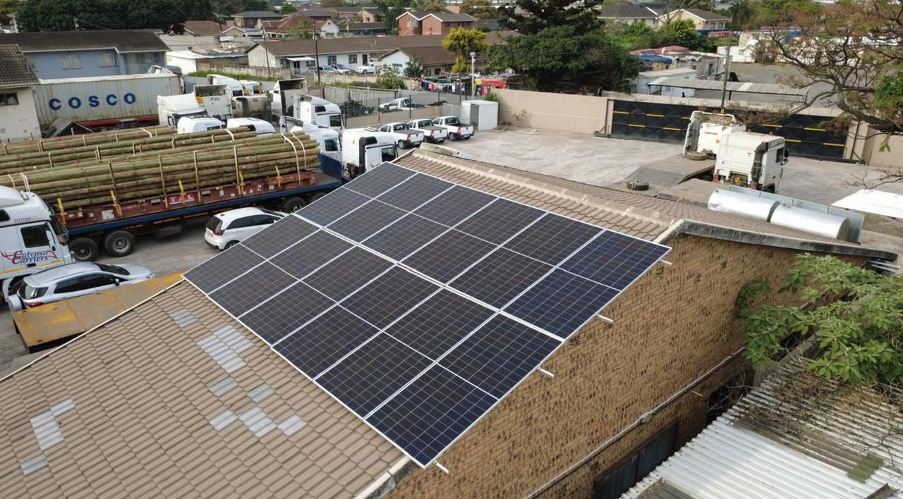

<div align="center">


# DUAL NATURE

**Solar · Infrastructure · Precision Manufacturing**
KwaZulu-Natal, South Africa

*In quantum mechanics, light is both a wave and a particle. We were built on the same principle.*

[www.dualnature.co.za](https://www.dualnature.co.za) · 067 400 7509 · admin@dualnature.co.za

</div>

---

## The site

A cinematic rebuild of the Dual Nature website — same content, same photography, same brand — on the NVTRA design system, now as a Next.js app.



| Page / section | What it does |
|---|---|
| **Home · Hero** | A live WebGL field of light that moves as a **wave**, then collapses into the logo's three **particles** as you scroll. |
| **Home · Solar ROI** | Savings calculator driving a glowing **Peak Chart** — bill, offset and property type reshape the 25-year net position; switch horizon (10 / 15 / 25 yrs) from the chart; drag to read any year. |
| **Home · Work, Process, Products** | Flagship install specs, swipeable gallery + lightbox, install lifecycle, precision manufacturing. |
| **Home · Contact** | Quote form posting to `/api/quote` (validated server-side), with an email-app fallback. |
| **/about** | A 3D **perspective tunnel** of real installs you fly through by scrolling, then the story: the ledger, why Dual Nature wins, the flagship, who it's built for. |

### Built for phones first
- Phone layouts designed separately — no scroll-jacking on touch; the About tunnel runs on native scroll
- Snap-swipe carousels, swipe in the lightbox and process card, touch-drag readout on the chart
- Floating **Call · Get a quote · Email** dock in thumb reach, hidden near the form
- 44 px+ tap targets, 16 px inputs (no iOS zoom), safe-area aware, no horizontal overflow
- Lighter 3D on mobile, paused off-screen; respects *reduce motion*; light / dark theme

## Stack
Next.js 16 (App Router) · TypeScript · Tailwind CSS v4 · shadcn project structure (`components/ui`, `lib/utils.ts`, `components.json`) · framer-motion · three.js

```
app/
  page.tsx            # home
  about/page.tsx      # about + tunnel hero
  api/quote/route.ts  # quote endpoint
  globals.css
components/
  ui/peak-chart.tsx              # Peak Chart (Louis Studios)
  ui/perspective-tunnel-hero.tsx # tunnel hero (scroll-driven)
  solar-calculator.tsx · quote-form.tsx · hero-scene.tsx · site-chrome.tsx · site-effects.tsx
lib/  hero-scene.ts · site.ts · utils.ts
public/img/           # original Dual Nature photography + logo
```

## Run locally
```bash
npm install
npm run dev
```
Open http://localhost:4173.

## Quote emails (optional)
Copy `.env.example` to `.env.local` and set `RESEND_API_KEY` (from resend.com) to have quote requests emailed straight to `admin@dualnature.co.za`. Without it, the form opens the visitor's email app with everything filled in.

## Deploy
Import the repo into Vercel — it detects Next.js automatically. Add the env vars above in Project Settings if you want server-sent quote emails.

---

<sub>© 2026 Dual Nature (Pty) Ltd · KwaZulu-Natal, South Africa · 100% CoC-certified</sub>
