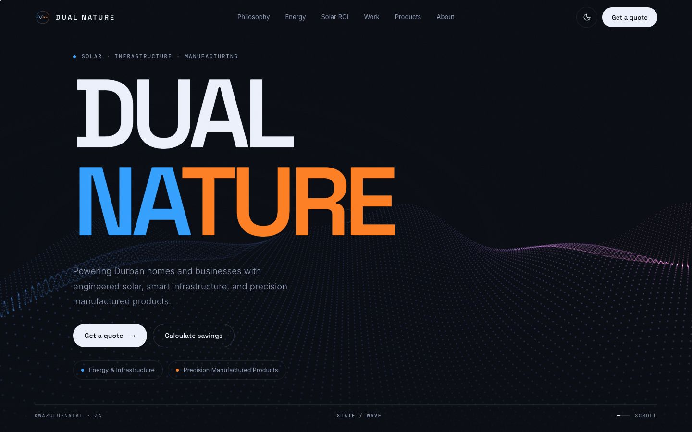
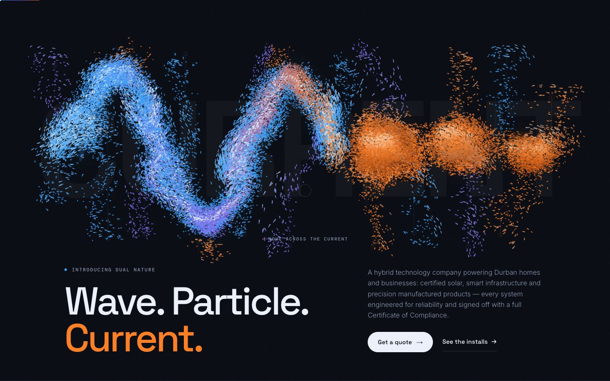
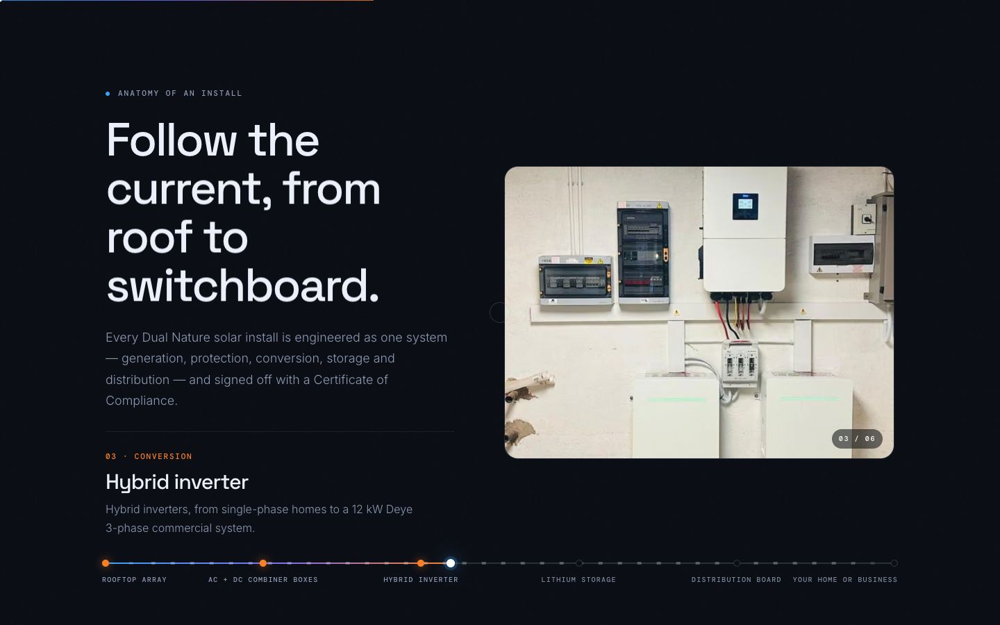
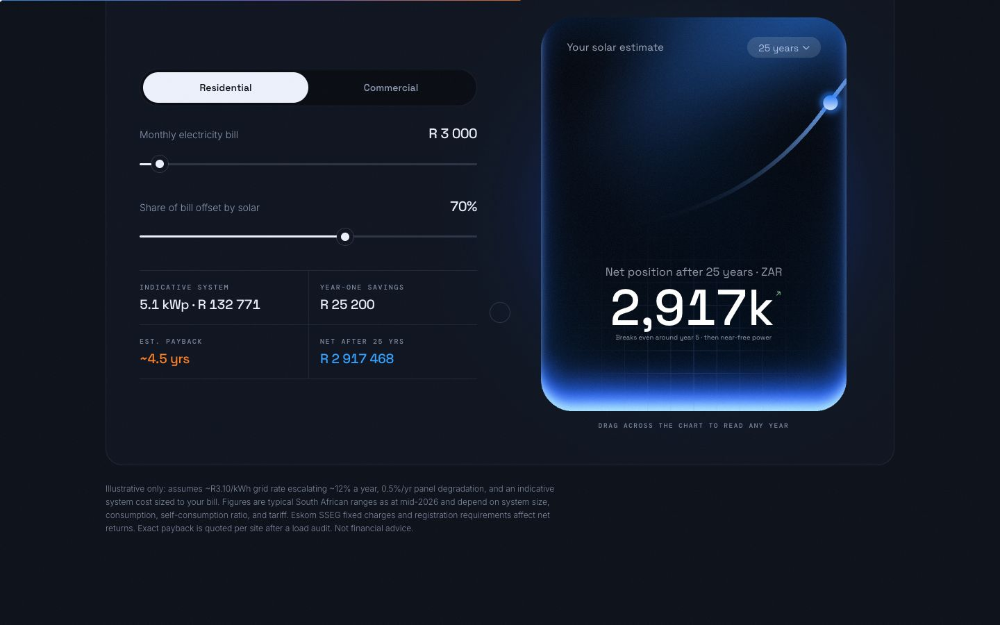
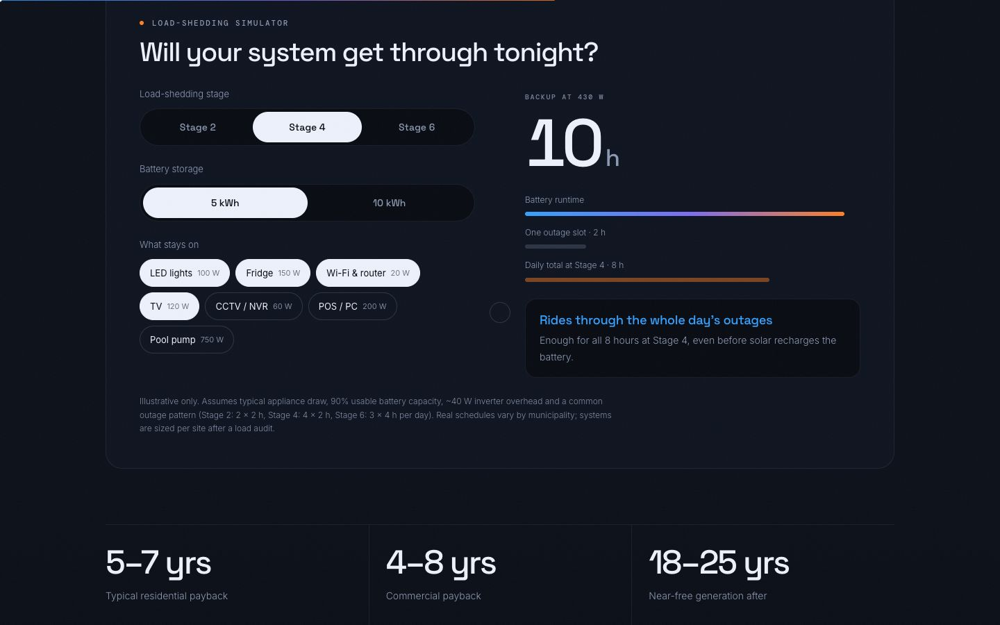
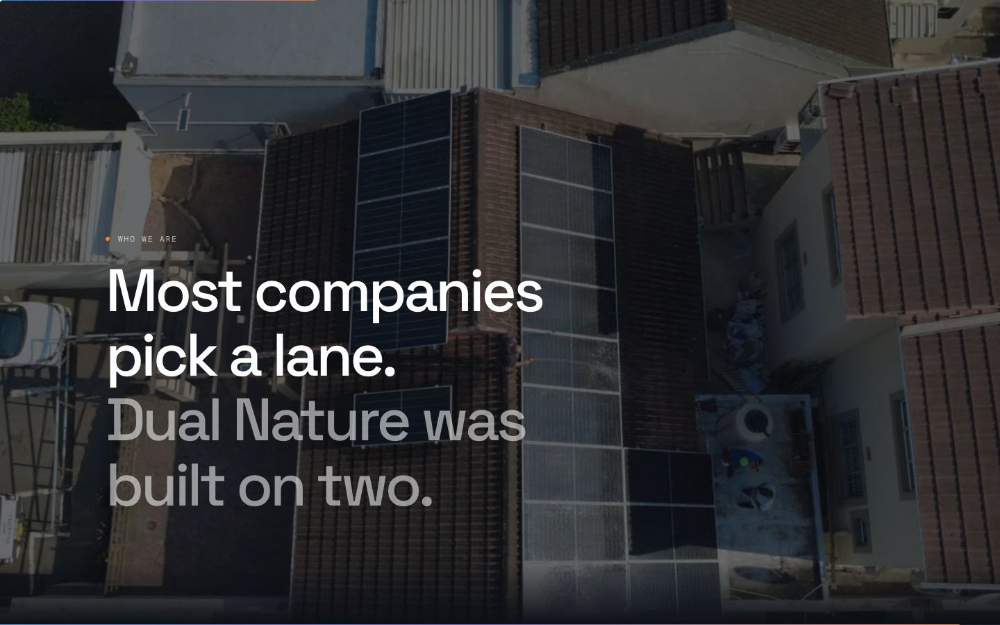
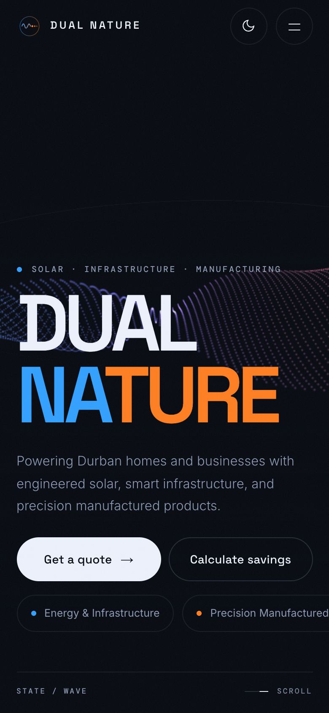
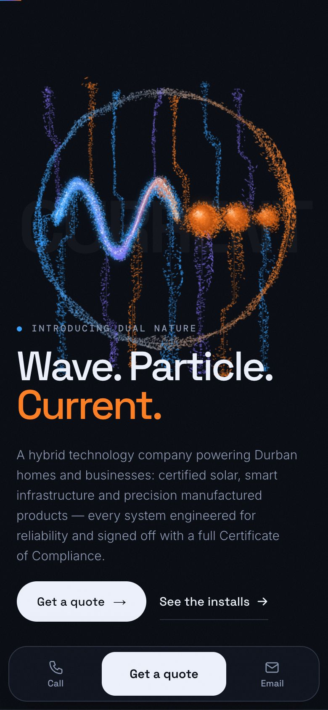
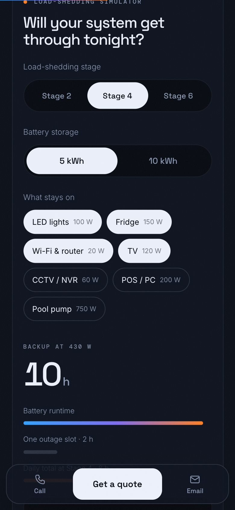

<div align="center">


# DUAL NATURE

**Solar · Infrastructure · Precision Manufacturing**
Durban & KwaZulu-Natal, South Africa

*In quantum mechanics, light is both a wave and a particle. We were built on the same principle.*

[www.dualnature.co.za](https://www.dualnature.co.za) · 067 400 7509 · admin@dualnature.co.za

<br>



</div>

---

## The site

| | |
|---|---|
|  | **Live Current — the 3D centrepiece.** The Dual Nature mark rebuilt from tens of thousands of GPU-simulated particles. Current pulses run along the wave into the three particles; touch it and it turns to liquid plasma that arcs like electricity; tap for a surge. Assembles from sparks the first time it comes into view. |
|  | **Anatomy of an install.** Scroll the current from roof to switchboard: array → combiner boxes → hybrid inverter → lithium storage → distribution board → certified sign-off, using real install photos. |
|  | **Solar ROI calculator.** Bill, offset and property type drive a live Peak Chart of your 25-year net position; switch the horizon from the chart and drag to read any year. |
|  | **Load-shedding simulator.** Pick a stage, a 5 or 10 kWh battery and what stays on — see hours of backup and whether you ride through. |
|  | **About.** Fly through a corridor of facts, products and installs; the last card expands to full screen and the story begins. |

Also: a wave-to-particle hero, a scroll-through tunnel of real installs into the flagship project, services, process, precision products, and a quote form.

### Built for phones first

<p>



</p>

- Layouts designed for the thumb, not shrunk: snap-swipe carousels, a vertical install stepper, a floating **Call · Get a quote · Email** dock
- Native scrolling everywhere on touch — nothing traps the page; smooth scrolling only for mouse and trackpad
- 44 px+ tap targets, 16 px form inputs, safe-area aware, no horizontal overflow from 360 px up
- Lighter 3D on low-power devices; every WebGL scene pauses off-screen and falls back gracefully without WebGL
- Light and dark themes, reduced-motion support, keyboard accessible

### Quality

| Lighthouse (mobile) | Performance | Accessibility | Best practices | SEO |
|---|---|---|---|---|
| Home | 91 | 100 | 100 | 100 |
| About | 92 | 100 | 100 | 100 |

Desktop: 100 across the board.

## Stack

Next.js 16 (App Router) · TypeScript · Tailwind CSS v4 · shadcn project structure · framer-motion · three.js · WebGL2 · Lenis

```
app/
  page.tsx               home
  about/page.tsx         about + tunnel
  not-found.tsx          "particle lost" 404
  api/quote/route.ts     quote endpoint (validated, rate-limited)
  opengraph-image.tsx    generated share cards (+ about/)
  sitemap.ts robots.ts manifest.ts icon.svg apple-icon.tsx
components/
  ui/liquid-sculpture-hero.tsx    GPU particle sculpture engine
  ui/perspective-tunnel-hero.tsx  scroll-driven 3D tunnel
  ui/peak-chart.tsx               ROI chart
  live-current.tsx  install-anatomy.tsx  loadshedding-sim.tsx  solar-calculator.tsx  quote-form.tsx …
lib/
  current-art.ts   the Live Current artwork, drawn in code
  hero-scene.ts    wave → particle hero (three.js)
  seo.ts env.ts site.ts …
proxy.ts           per-request CSP nonce
```

## Run locally

```bash
npm install
npm run dev
```

Open http://localhost:4173. `npm run typecheck` and `npm run build` are what CI runs.

## Environment (all optional)

| Variable | What it does |
|---|---|
| `RESEND_API_KEY` | Emails quote requests to the inbox via [Resend](https://resend.com). Without it, the form opens the visitor's email app with everything filled in. |
| `QUOTE_TO_EMAIL` | Where quotes go. Defaults to admin@dualnature.co.za. |
| `QUOTE_FROM_EMAIL` | Sender on a domain verified in Resend, e.g. `Dual Nature Website <quotes@dualnature.co.za>`. |
| `UPSTASH_REDIS_REST_URL` / `UPSTASH_REDIS_REST_TOKEN` | Shared rate limiting across serverless instances. Without them, limits are per instance. |

See `.env.example`.

## Deploy

Import the repository into Vercel — it detects Next.js. Add any environment variables above in **Project → Settings → Environment Variables**, and enable **Analytics** and **Speed Insights** in the Vercel dashboard (quote submissions are tracked as an event).

## Security

Strict per-request Content-Security-Policy, HSTS, frame and permissions lockdown, a hardened quote endpoint, pinned dependencies, CI and Dependabot. See [SECURITY.md](SECURITY.md).

---

<sub>© 2026 Dual Nature (Pty) Ltd · KwaZulu-Natal, South Africa · 100% CoC-certified</sub>
